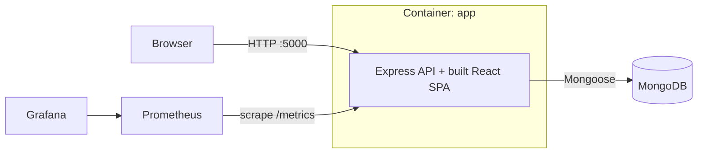

# Student Task Manager — DevOps project

A task manager for students (register, log in, create / edit / complete / delete tasks) used as the vehicle for a
complete DevOps toolchain: tests at three levels, containers, two CI/CD systems, Kubernetes, monitoring and
security checks.

| Layer | Tech |
|---|---|
| Frontend | React 18, Vite, TypeScript, Tailwind + shadcn/ui |
| Backend | Node 20, Express 5, Mongoose, JWT auth |
| Database | MongoDB 7 |
| Container | Multi-stage Dockerfile, non-root, health-checked, one image serves API + SPA |
| CI/CD | **GitHub Actions** (`.github/workflows`) and **Jenkins** (`Jenkinsfile`) |
| Orchestration | Docker Compose, Kubernetes (kustomize) |
| Observability | Prometheus metrics (`/metrics`), Grafana dashboard, alert rules |

## Architecture



The React build is baked into the image at `docker build` time and served by Express, so there is a single deployable
unit. Endpoints used by operations: `GET /health` (liveness), `GET /ready` (database connected), `GET /metrics`.

## Repository layout

```
backend/            Express API, unit + integration tests (Jest, Supertest)
frontend/           React app, unit tests (Vitest, Testing Library)
e2e/                Selenium end-to-end tests (pytest) + Dockerfile
Dockerfile          Multi-stage: frontend build, test targets, production runtime
docker-compose.yml          App + MongoDB
docker-compose.monitoring.yml   Adds Prometheus + Grafana
docker-compose.ci.yml       Tests inside containers (used by Jenkins)
docker-compose.e2e.yml      Selenium tests against the real stack
Jenkinsfile         Jenkins pipeline
jenkins/            Jenkins controller image (Docker CLI included) + compose file
.github/workflows/  ci.yml (every push/PR), release.yml (tags -> GHCR)
k8s/                Kustomize manifests: Deployment, StatefulSet, HPA, Ingress, probes
monitoring/         Prometheus config, alert rules, Grafana provisioning + dashboard
Makefile            Shortcuts for everything below (run `make help`)
```

## Quick start

```bash
cp .env.example .env
# put a random value in JWT_SECRET:  openssl rand -hex 32
docker compose up -d --build
open http://localhost:5000
```

Local development without Docker for the app: run MongoDB, then in `backend/` `npm run dev` (needs `MONGO_URI` and
`JWT_SECRET` in `backend/.env`) and in `frontend/` `npm run dev` (Vite on :8080 proxies `/api` to :5000).

## Testing

| Level | What | Command | Where it runs in CI |
|---|---|---|---|
| Lint | ESLint backend + frontend, TypeScript typecheck | `make lint` | both pipelines |
| Backend unit / integration | Auth, task CRUD, per-user isolation, validation, NoSQL-injection payloads, health/ready/metrics, DB retry. Real MongoDB (in-memory, or `TEST_MONGO_URI`). Coverage gate: 80 % | `make test` | both pipelines |
| Frontend unit | API client, login flow | `make test` | both pipelines |
| End-to-end | 15 Selenium tests through the real UI, API and database | `make e2e` (Docker) or see below | both pipelines |
| Everything in containers | Same tests, nothing installed locally | `make test-docker` | Jenkins |

### Running the Selenium tests without Docker

Start MongoDB and the app (`npm run build` in `frontend/`, link or copy `frontend/dist` to `backend/dist`, then
`MONGO_URI=... JWT_SECRET=... PORT=5055 node backend/server.js`), then:

```bash
cd e2e && python3 -m venv .venv && .venv/bin/pip install -r requirements.txt
BASE_URL=http://localhost:5055 .venv/bin/python -m pytest -v
```

Selenium Manager downloads a matching Chrome and driver automatically if Chrome is not installed.

## CI/CD

Both pipelines follow the same flow: **lint + tests (parallel) → build image → vulnerability scan (Trivy) →
Selenium e2e against the fresh image → publish → deploy**.

- **GitHub Actions** — `ci.yml` runs on every push and PR (backend with a Mongo service container, frontend, image +
  scan + e2e, config validation). `release.yml` publishes `ghcr.io/<owner>/<repo>:<version>` when you push a `v*` tag.
- **Jenkins** — `Jenkinsfile` runs the same stages in Docker, pushes to Docker Hub and deploys with Compose on `main`,
  then smoke-tests `/ready`. It archives the Selenium HTML report and emails the committer.
  Start a local controller with `make jenkins` (http://localhost:8081) and create credentials
  `dockerhub-credentials` and `stm-jwt-secret`.

## Monitoring

```bash
# GRAFANA_ADMIN_PASSWORD must be set in .env
make monitoring
```

Prometheus: http://localhost:9090 · Grafana: http://localhost:3001 (user `admin`). The "Student Task Manager"
dashboard (requests/s per route, p95 latency, status codes, memory) is provisioned automatically.
`monitoring/alerts.yml` defines AppDown, HighErrorRate and SlowRequests.

## Kubernetes

```bash
docker build -t student-task-manager:latest .          # for a local cluster (Docker Desktop / kind / minikube)
kubectl apply -f k8s/namespace.yaml
kubectl -n student-task-manager create secret generic app-secrets \
  --from-literal=JWT_SECRET="$(openssl rand -hex 32)"
kubectl apply -k k8s
kubectl -n student-task-manager port-forward svc/app 8080:80     # http://localhost:8080
```

Two replicas with rolling updates (`maxUnavailable: 0`), liveness on `/health`, readiness on `/ready`, an HPA on CPU,
MongoDB as a StatefulSet with a persistent volume, and a hardened pod (non-root, read-only filesystem, all
capabilities dropped). The secret is intentionally not stored in git.

## Security notes

- The JWT secret is mandatory and never in git (the first version hard-coded one in `docker-compose.yml`; if you ever
  used that value anywhere real, rotate it).
- Passwords are hashed with bcrypt; login errors do not reveal whether an email exists; request bodies are validated so
  object-shaped payloads (`{"$ne": null}`) are rejected.
- Rate limiting on `/api/auth`, `helmet` headers, JSON body limit, non-root container, image scanning in CI.
- Dependencies are audited in CI (`npm audit`, fails on critical). `mongoose` is kept on a patched release, with the
  MongoDB driver pinned to 7.1.0 (`overrides` in `backend/package.json`) because driver 7.7+ failed the connection
  handshake against MongoDB 7 in CI; unpin when a fixed driver ships.
- Not done yet: a Content-Security-Policy (disabled in `backend/app.js`), HTTPS termination (put a reverse proxy or the
  Kubernetes Ingress with TLS in front), and secret management beyond env vars / Kubernetes Secrets.
